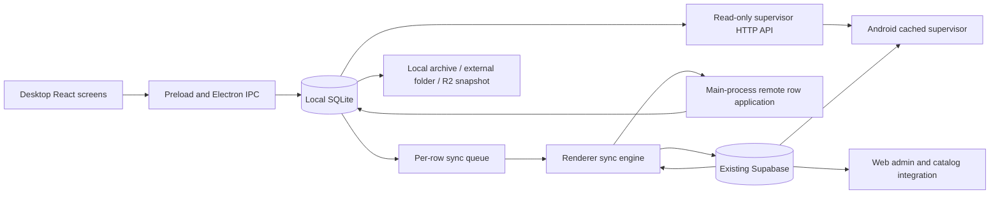

# SMLPOS: data structure and workflow audit

Audit date: 2026-10-24. Environment: development computer, confirmed by the user.

The application is a local SQLite POS with several related accounting and document representations, an existing partial Supabase replication mechanism, a read-only Android supervisor, and a separate web-admin app. It is not currently a complete, transactionally consistent multi-device system.

This is a source audit, not a certification of the client's database. No business database was opened, copied, migrated or uploaded. The expected development DB and canonical packaged DB were absent on this machine. Application code, dependency files and server configuration were not changed. Files added under this directory are audit artifacts only.

## Read this material in order

1. This report explains ownership, business workflows, calculations, risks and migration implications.
2. [DATA_DICTIONARY.md](DATA_DICTIONARY.md) lists every column, type, default, primary key, declared FK, index and CHECK expression, including subsequent ALTER TABLE additions.
3. [WRITE_PATHS.md](WRITE_PATHS.md) inventories SQL write candidates with source locations. It is a lexical navigation index, not a complete dynamic call graph.
4. [SYNC_COVERAGE.md](SYNC_COVERAGE.md) compares local columns and tables with the existing push whitelist and pull allowlist.
5. [BASELINE.sql](BASELINE.sql) captures schema and counts on a verified copy. [RECONCILIATION.sql](RECONCILIATION.sql) checks relationships, money, stock, JSON and stored balances. Neither was run against business data.
6. [source-inventory.json](source-inventory.json) provides machine-readable schema, write candidates and source hashes. [audit_sources.py](audit_sources.py) regenerates the dictionary without running the application.

## 1. Evidence and limits

The schema was reconstructed by extracting literal CREATE TABLE, CREATE INDEX and ALTER TABLE statements from `src/main/db.ts` and applying only those statements to an in-memory SQLite database. No DML, seeds, business migrations, imports or Electron startup code was executed. Duplicate ADD COLUMN declarations were recorded and ignored, as required for a fresh schema that already contains those columns.

Result: **43 distinct tables, 536 columns, 28 declared FK relationships, 116 successfully applied DDL statements, zero unhandled DDL errors**. There are 44 CREATE TABLE declarations because `remboursements_ventes` is declared twice. This reconstruction models a fresh installation. An older deployed database can differ because of conditional migrations, ignored errors and different historical column definitions.

Source inspection covered desktop schema/IPC/preload, money and document helpers, cart persistence, synchronization, backup/reset/recovery, mobile data/cache/auth, web-admin queries and Supabase/integration SQL. Key mutations were traced across their related tables. This does not mean every UI interaction was executed, every reporting query was numerically verified or every branch was dynamically tested.

The client database's row counts, history, corruption status, deployment schema, orphan records, balance discrepancies, actual R2 backups, configured policies and deployed app version remain unknown. There is no basis to claim that real data has already been lost or that the code findings have already affected this client's records.

The supplied `pos-sync-kit.zip` is a proposed target specification, not the current implementation. Its instructions were read as document content. This audit does not authorize installing its files as repository instructions, running commands from it or provisioning a server.

## 2. Application and storage boundaries

| Layer | Data ownership and access | Source |
|---|---|---|
| Desktop renderer | React/Vite UI, Zustand state, cart calculations, IPC calls; Supabase upload/pull scheduling | `src/renderer/src/App.tsx`, `store/`, `lib/sync.ts` |
| Preload | Named `window.api` methods using `ipcRenderer.invoke`; generic SQL methods also exposed but registered in main only in development | `src/preload/index.ts` |
| Electron main | `better-sqlite3`, schema initialization, business mutations, backup/reset, printing and read-only supervisor HTTP API | `src/main/db.ts`, `src/main/index.ts` |
| Packaged SQLite | `%APPDATA%\SMLPOS\smlpos.db` | `src/main/dataPaths.ts:65`, `src/main/userDataWipe.ts:34` |
| Development SQLite | `<working directory>\smlpos-dev.db` | `src/main/userDataWipe.ts:34` |
| Local backups | Canonical app-data `backups/`, external folder if configured | `src/main/backupService.ts` |
| Archive | `%APPDATA%\SMLPOS-Archive`, outside reset's normal app folder; rotation still applies to scheduled backups | `src/main/dataPaths.ts`, `src/main/backupService.ts` |
| Android | Expo/React Native read-only supervisor; HTTP/Supabase reads, AsyncStorage snapshots | `mobile/src/lib/data.ts`, `hooks/useRows.ts` |
| Web admin | Separate Next.js app querying Supabase | `apps/web-admin/src/app/` |
| Website integration | Documented Supabase catalog consumer; category text remains significant | `integrations/smlsite/README.md` |

SQLite uses WAL and foreign keys are enabled by initialization. Foreign keys protect only the relationships actually declared. Many columns named `*_id` are logical links with no declared constraint. Almost all IDs are TEXT; generators include UUIDv4, fixed seed IDs, timestamp-based IDs and business-derived IDs. UUIDv7 is a future requirement, not current behavior.

Most SQL/business logic is concentrated in a large main-process file rather than an ORM or a dedicated repository layer. Generic SQL IPC is development-only, not an unrestricted production SQL API.

## 3. Startup changes data

The normal application must not be used as a read-only database viewer.

Startup calls pending-wipe handling, legacy data promotion and recovery **before** the normal pre-migration backup, then opens SQLite. It backs up if possible, runs schema initialization and seeds/imports, rounds stored money, repairs historical quote stock, repairs external-treasury double deductions, and realigns daily treasury totals. Initialization also restores serials linked to cancelled sales/documents, sets product serial flags, imports legacy repair JSON when found and marks that import complete.

Legacy promotion/recovery uses product counts as a selection signal. More products does not prove that a candidate has newer invoices, payments or repair history. Migration must explicitly choose the authoritative file; it must not rely on this heuristic.

References: `src/main/db.ts:12`, `src/main/index.ts:672`, `src/main/dataPaths.ts:129`, `src/main/userDataWipe.ts:114`.

## 4. Business domains and the role of every table

The full physical definitions are in the dictionary. This table explains why each exists and what must be preserved.

| Domain | Table | Meaning / important behavior |
|---|---|---|
| Identity | `operateurs` | Operator profile, login identifier, role and active flag. Not a server-issued identity/session model. |
| Catalog | `categories` | Category names/icons. Products retain both category text and an optional category ID. |
| Catalog | `produits` | Master catalog, F/NF type, prices/tax fields, supplier references, mutable stock, active flag, serial-tracking flags. |
| Catalog | `serial_numbers` | Per-unit serial state. `vente_id` means a sale when sold, but can mean an advance dossier when reserved. |
| Supplier | `fournisseurs` | Supplier contact/tax/bank details and stored `solde_du`. |
| Supplier | `fournisseur_commerciaux` | Multiple contacts for one supplier. |
| Purchase | `factures_fournisseurs` | Invoice/BL/draft, totals, withholding, paid amount, reception and `stock_applied`. |
| Purchase | `lignes_facture_fournisseur` | Purchased items, quantities, old/new purchase costs, suggested/applied sale prices, serial JSON and draft product JSON. |
| Purchase | `paiements_fournisseurs` | Payment history; cash origin and installment mode encoded in notes. |
| Purchase | `ajustements_fournisseurs` | Manual additions/removals from supplier debt, reason and optional cash effect. |
| Customer | `clients` | Customer profile, organization/agent, credit limit and stored credit/loyalty balances. |
| Customer | `organisations` | Group accounts; stored credit total also recomputed from associated clients in some paths. |
| Credit | `credits_clients` | CREDIT raises debt; PAIEMENT lowers it. Entries may include product-credit metadata and installment plans in notes. |
| Deposit | `avances_clients` | Each row is a receipt; several rows can share one dossier. Product reservations, optional automatic invoice, status and links. |
| Loyalty | `mouvements_fidelite` | Gain, use, cancellation of gain, restitution; snapshots of balance before/after. |
| Sale | `ventes` | POS transaction or quote, totals, tender mode/received/change, customer snapshots, optional deposit and loyalty usage. |
| Sale | `lignes_vente` | Sold item snapshots, quantity, TTC unit price in the ordinary POS flow, discount and serials. Product ID can be absent for free-form items. |
| Invoice | `factures_clients` | Earlier invoice representation linked to a sale; still referenced by conversion/exchange/daily-invoice logic. |
| Document | `documents` | Current document header: invoice, daily F invoice, quote, BL, credit note; customer snapshot, totals, layout/content, origin/reversal links. |
| Document | `lignes_document` | Printed/accounting lines with HT/TVA/TTC; ordinary invoice builders derive HT unit prices from TTC cart prices. |
| Refund | `remboursements_ventes` | Whole-sale cancellation refund; at most one row per sale due to a unique constraint. |
| Return | `retours` | Product return, condition, resolution, quantity and reimbursement. Separate from whole-sale cancellation and exchange. |
| Exchange | `mouvements_echange` | Supplemental money received/refunded on an exchange, with old/new totals and replacement/return JSON. |
| Online | `ventes_en_ligne` | Order, JSON item list, delivery and return fees, received/net amounts and status-driven inventory/cash effects. |
| Repair | `reparations` | Repair job, customer/device snapshots, estimates, deposit, final price, technician spending/profit, status and payment note marker. |
| Repair | `pieces_reparation` | Parts/costs; `destock_stock` decides whether creation reduces stock. |
| Repair | `reparation_status_history` | Imported repair status history; regular status changes do not currently append here. |
| Service | `services_pos` | Barcode-addressable service definitions. |
| Service | `transactions_services` | Collected service fees linked to shift/service; not the same measure as product turnover. |
| External cash | `shifts` | Morning/evening external till sessions, opening fund, close information and stored counters. |
| External cash | `sorties_caisse` | Expenses/refunds charged to a shift, sometimes linked to an internal movement. |
| External cash | `rapports_caisse` | Close snapshots with JSON summary/operations. Intended as history, but close handler can update an existing snapshot. |
| Internal cash | `caisse_interne` | Daily opening balance and mutable entry/exit totals; day balance = opening + entries − exits. |
| Internal cash | `mouvements_caisse_interne` | Treasury movements. Currently accompanied by stored totals rather than being the sole derived source. |
| Internal cash | `mouvements_tresorerie_attente` | Approval inbox. `impact_applique` prevents already-applied cash effects being applied again on acceptance. |
| Personnel | `personnels` | Employee profiles, salary, stored advance and credit balances. |
| Personnel | `mouvements_personnels` | Salary/advance/credit/repayment movements; product/cash origin encoded in note metadata. |
| Requests | `demandes_clients` | Product/part/callback requests, responsible operator, deadline, priority, advance field and completion state. |
| Cart | `saved_paniers` | Durable held carts and the reserved active-draft ID; full cart JSON payload. |
| Settings | `app_settings` | Shared business/print/tax settings mixed with machine paths, sync flags and sensitive configuration. Active draft is stored in `saved_paniers`. |
| History | `activity_logs` | Best-effort activity logging. Some writes bypass the helper and enqueue explicitly; the helper itself does not enqueue. |
| Sync | `sync_queue` | Per-row INSERT/UPDATE/DELETE payloads, retry counts/errors and acknowledgment time. Local infrastructure. |
| Repair bookkeeping | `inventory_repair_ledger` | Composite key prevents repeating historical quote-inventory repairs. Not an inventory movement ledger. |

## 5. Relationships that are not apparent from foreign keys

- Sale → sale lines is an enforced FK, but sale → customer and sale → shift are plain TEXT links. Line → product is also usually a plain TEXT link.
- Documents link to sales/customers/suppliers through plain TEXT IDs. Daily invoices additionally refer to multiple sales via `contenu_json.vente_ids` and business date metadata.
- `documents.avoir_id`, `document_origine_id`, `reference_source_id` and `facture_origine_numero` connect document history without declared self-FKs.
- Deposits use `dossier_id` as an implicit root/group identifier. Root rows often have `id = dossier_id`. Product JSON can carry multiple products despite scalar `produit_id`/`numero_serie` columns describing the first item.
- `serial_numbers.vente_id` is polymorphic: it is not safe to require every non-null value to exist in `ventes` without checking status and deposit dossiers.
- Organization association can match an organization ID **or a normalized organization name**. A strict UUID migration must resolve legacy text matches explicitly.
- Cash `reference_id` and derived IDs such as `mci-*` reference different business objects depending on category; these are not one universal FK.
- Customer/operator/product descriptions copied into historical rows are snapshots. Do not replace them with the current profile/catalog value during migration.
- Empty strings are often used alongside NULL for absent links. A migration must classify them before enforcing strict server FKs.

## 6. Main workflows, from input to resulting records

### 6.1 Catalog, stock and serials

Products have both human reference/barcode uniqueness and an internal TEXT ID. Soft deletion commonly sets `actif=0`. Prices, category text/ID, supplier text/ID and pricing calculation fields coexist. Suggested purchase margins are informational; only explicit `prix_vente_applique` changes the catalog sale price on purchase receipt.

There is no general stock-movements table. `stock_actuel` is directly changed by purchases, sales, credit-product delivery, repairs, returns, online orders, exchanges, cancellation, imports, manual adjustments and startup repairs. Some paths reject insufficient stock, some clamp at zero, and some subtract without a guard. These policies are not interchangeable.

Serial lifecycle: EN_STOCK → VENDU, or EN_STOCK → RESERVE_AVANCE → VENDU; cancellation can restore EN_STOCK or reinstate reservation. DEFECTUEUX is a possible stored state. A product-level legacy serial field and per-line serial strings also coexist with the per-unit table. The DB does not declare serial uniqueness; application code performs normalized lookups/checks. `serialNumbers:getByProduit` can recover missing serials from purchase history, so this apparently read-oriented operation writes data.

References: `src/main/index.ts:1896`, `2032`, `2065`, `2218`, `2260`, `2285`, `2339`.

### 6.2 Checkout and a normal sale

1. Cart state calculates line totals, discounts and payable amount. UI generates a sale number/ID and line IDs.
2. Checkout calls `ventes:create`; main normalizes money to three decimals, requires a shift for a VENTE, validates free-item reasons, deposit ownership/serials and loyalty use.
3. A local transaction inserts the sale and lines, consumes stock/serials, adjusts loyalty entries/balance and marks a used deposit dossier converted.
4. After commit, activity and sync snapshots are queued. A failure between the business commit and queue creation can leave local success without upload intent.
5. Ticket, invoice, quote and BL presentation/conversion may follow as a separate operation. Sale and document creation are not universally one atomic business transaction.

Normal checkout stores TTC cart unit prices in sale lines. A quote is represented by a sale row with `type_vente=DEVIS`; it does not consume stock or earn/use loyalty, and cash reporting excludes it. The main handler still requires a shift for VENTE records, including that quote path. Its serial validation still checks the selected serials.

References: `CheckoutModal.tsx:180`, `src/main/index.ts:2489`.

### 6.3 Invoices, quotes, BL and daily F invoices

The code distinguishes F/NF products. Linked invoice/quote creation filters out NF lines; BL permits both. A standalone document path does not apply exactly the same linked-sale filtering conditions. Preserve actual line types rather than inferring them from the document name.

`documents` and `factures_clients` overlap historically. A document usually represents an already-recorded sale rather than additional turnover. A daily F invoice groups eligible F ticket-sale lines for a local business day, excluding quotes, cancellations and already-invoiced sales. It stores contributing sale IDs/date metadata; it can be rebuilt, edited through exchange effects or revoked when eligibility disappears. It is separate from morning/evening cash reports.

Line calculations ordinarily start from TTC cart price: discounted line TTC = quantity × TTC unit × (1 − discount/100); HT = TTC/(1 + tax rate/100); TVA = TTC − HT, rounded to three decimals. Print net payable includes applicable stamp and cart discount. Tax buckets and line/document totals must be reconciled with those rules; `SUM(lines)=header` is not universally sufficient without cart-discount/stamp treatment.

References: `documentProductRules.ts`, `invoiceLineCalc.ts`, `documentFromCart.ts`, `src/main/index.ts:1546`, `3298`, `5384`.

### 6.4 Editing, exchange, return, cancellation and credit notes

- Document-line editing deletes/recreates lines and may restore/reconsume linked sale stock. It also rebuilds linked sale lines. See finding F04 for header and unit-price consistency.
- Exchange validates selected returned quantities/serials, restores old stock, writes replacement sale lines, consumes new stock and records cash difference. Direct and daily documents plus legacy invoice totals can be rewritten.
- A normal return inserts `retours`; SANS_PROBLEME adds stock back. A positive refund linked to a shift creates `sorties_caisse`. This handler lacks an enclosing transaction across these effects.
- Sale cancellation is guarded against an already-cancelled sale, restores stock/serials, records a unique whole-sale refund, may reopen a deposit dossier, revokes a linked invoice if chosen without an avoir, and reverses loyalty.
- Cancellation with an avoir creates negative document totals/lines and links original/credit note. It restores linked sale stock and can reopen the deposit reservation. This path does not implement the same loyalty reversal as ordinary sale cancellation.
- Revocation alone changes document status and audit metadata; it is not a general stock/cash reversal command.

Whole-sale refunds, return refunds and exchange refunds are distinct representations. They must not be mechanically merged or counted twice.

References: `src/main/index.ts:4675`, `4845`, `5082`, `5521`, `5610`, `5753`.

### 6.5 Supplier purchasing and payments

Drafts are saved under supplier invoice/line tables with BROUILLON status; pending product/serial JSON preserves incomplete entry. Final creation inserts invoice/lines, optionally replaces a draft, updates purchase price, optionally applies an explicitly chosen sale price, receives quantities/serials and increases supplier debt in a transaction.

Submitted invoices/BL default to received and stock-applied. An unreceived BL has a separate receipt path guarded by reception and `stock_applied`. Receipt must be distinguished from merely saving a draft. Purchase cancellation refuses invoices with payments and refuses reversing serials no longer available; it reverses inventory and supplier debt.

Payment reads remaining net due, supports full outstanding or a partial installment, inserts a payment, increases invoice paid amount, changes status, reduces supplier balance and charges either internal treasury or external shift. Notes encode this cash-source distinction. Manual balance adjustments also exist independently of purchase invoices.

The implementation currently calculates a 1% withholding when supplier gross total is at least 1000. This audit describes code behavior, not legal correctness. Changing invoice totals later does not consistently reconcile the stored supplier balance; see F05.

References: `src/main/index.ts:3413`, `3502`, `3533`, `3559`, `3624`, `3714`, `3814`, `3894`.

### 6.6 Customer credit and organizations

A credit can be opening debt, money credit or a product handed to a customer. CREDIT increases stored debt; PAIEMENT reduces it and can contribute to a shift. Product-credit metadata lives in a note marker and creation reduces stock. There need not be an ordinary POS sale/invoice for every product-credit row.

Organization credit is recomputed in some paths from active clients, matching ID or normalized organization name. Client creation supports an initial credit, but insertion/customer balance/history are not one enclosing transaction. Credit editing recalculates debt and some cash/product effects, but edits historical entries rather than recording immutable reversals.

Installment schedules are JSON inside the note, not separate scheduled-payment rows. Migration must preserve amount, months, first-payment date and installment rounding behavior, along with the original note.

References: `src/main/index.ts:4220`, `4310`, `4369`; `creditInstallments.ts`.

### 6.7 Deposits, reservations and automatic invoice

LIBRE deposits are free-purpose receipts. PRODUIT deposits group receipts under a dossier and hold product/serial information. Serial reservations set RESERVE_AVANCE and place the dossier ID in `serial_numbers.vente_id`; stock quantity remains physical stock while available-to-sell is reduced by reservations.

Several products/quantities can be embedded in `produits_json`, even though scalar columns reference the first item. Existing dossiers inherit root product/customer information. Receipts cannot exceed the dossier price under the product path. Fully paid dossiers can become SOLDE, or automatically create sale + invoice + stock consumption if invoice inclusion is selected, then become CONVERTI.

Deposit receipts already counted as cash must be subtracted from later sale cash contribution, while fiscal sale totals remain the full sale amount. Automatic deposit-invoice numbering uses a timestamp/random suffix rather than the normal latest-number sequence. Cancellation reopens some reservation state; multi-product restoration needs explicit regression cases.

References: `src/main/index.ts:1852`, `2505`, `4411`, `4480`.

### 6.8 Loyalty

Customer has a card identifier and stored balance. Checkout validates card, balance, minimum spend and max-use percent, records use then gain, and updates the balance. Movement uniqueness limits one sale/type combination. Regular cancellation inserts gain reversal and use restitution. Sale client linkage and loyalty movement history are essential to reproduce this on another device; syncing only the final customer balance is insufficient.

References: `src/main/index.ts:2528`, `4268`, `4300`, `5139`.

### 6.9 Repairs and services

Repair creation inserts job and parts, optionally consumes stock for `destock_stock` parts, records deposit and later updates final price/profit. `main_oeuvre` is used as technician spending/cost in final-price/profit calculations, so its name alone is misleading. Finalization and payment confirmation are separate handlers with different marker behavior.

Payment metadata is embedded in `notes_technicien` under `[SMLPOS_PAYMENT]`, including payment shift and final amount. Cash summaries infer legacy paid repairs from TERMINE/RENDU when no marker exists. Regular status changes update `reparations` and activity logs; they do not append to `reparation_status_history`, which currently receives the legacy JSON import.

Services have definitions and per-shift fee transactions. Shift summary returns service totals separately, but its final `moneyIn` expression excludes that service subtotal. Whether another representation makes that intentional must be resolved against real workflows; do not silently change the formula during sync work.

References: `src/main/index.ts:2696`, `2755`, `2838`, `2860`, `2881`, `3121`, `1425`, `1531`; `src/main/db.ts:972`.

### 6.10 External shift cash and internal treasury

The desktop permits one active shift and two sessions per local day, morning then evening. These are application checks, not distributed constraints. A new second device would share global shift rows under current sync behavior; shift ownership and store-day policy must be decided before multi-device operation.

External cash summaries aggregate sales excluding quotes/cancellations, repair deposits/payments, credit receipts, customer advances, exchange differences, expenses and whole-sale refunds. Original collected sale amount can be preserved as `montant_encaisse_initial` after exchange. These operational totals include sale modes beyond cash; they should not automatically be interpreted as physical banknotes in a drawer.

Cash reports deliberately calculate theoretical movement balance as entries − exits, excluding opening fund. Internal treasury uses opening + entries − exits, carrying forward the previous stored day balance or starting at 100. These are different meanings despite similar field names.

Pending treasury rows separate review from application. `impact_applique=1` means money already affected internal totals and acceptance must not apply it again. External shift transfer/day-total logic is distinct from individual internal withdrawals. Startup contains repairs for earlier double deductions and report realignment.

References: `src/main/index.ts:719`, `746`, `776`, `1225`, `1277`, `1425`, `3932`, `4004`, `4048`.

### 6.11 Online orders

Order items are JSON, not normalized order-line rows. Creation stores the order. CONFIRME subtracts product quantities; LIVRE stores receipt/delivery information; REGLE creates internal cash income and updates net amount; RETOUR creates a return-fee expense; ANNULE returns stock for certain previous states. There is no transaction around the complete status transition and no general guard requiring an allowed previous status. Repeating CONFIRME/REGLE/RETOUR can repeat effects. An existing order's status is not a sufficient idempotency key.

Reference: `src/main/index.ts:4108`.

### 6.12 Personnel, requests and carts

Personnel movements update stored advance/credit balances. Product credit reduces product stock; cash credit charges internal/external cash; salaries/advances create internal expenses. Repayment types reduce stored personnel debt. An explicit matching cash-receipt representation for every repayment is not present in this handler and needs business confirmation.

Customer requests have assignment/status/deadline and a numeric advance field but no enforced relationship to deposit receipts; do not assume that field is interchangeable with `avances_clients`. Saved carts/drafts persist JSON in SQLite, with localStorage as recovery copy. The active draft uses a reserved ID. Carts should not affect stock or revenue until conversion/checkout.

References: `src/main/index.ts:3160`, `5298`, `842`, `915`; `src/renderer/src/lib/panierHold.ts`.

## 7. Present synchronization behavior

The main-process allowlist and renderer table priorities/pull list cover 29 of the 43 tables. The other 14 include legitimate local infrastructure plus significant business history. See the generated coverage table for every omission and column difference.

Writes enqueue row payloads. Pending events for the same table/record are deleted and replaced with the latest payload; this is not a merged change set. INSERT followed by a partial UPDATE can therefore lose fields required to create the row remotely. Queue exceptions are swallowed. Many enqueues occur after committing business changes.

The renderer pushes roughly every 5 seconds, pulls every third poll and retries on focus/network events. Uploads are direct Supabase upserts/deletes, grouped per table rather than preserving one business transaction. Duplicate-key failures can acknowledge the entire attempted batch even when it was not applied. Failed entries reach a retry limit and can be purged after a day. Bootstrap is a different path, based on remote table emptiness; it uploads only selected tables and can purge their queue entries afterward.

Pull fetches full tables in 500-row pages without explicit stable ordering. It upserts local rows, skips rows with pending local payloads, and uses updated_at comparisons where available. Missing remote rows do not cause local deletions. Missing columns are bound to schema default strings/NULL, so local-only fields can be overwritten rather than preserved. This makes the incomplete remote whitelist a potential local data issue, not just a missing-copy issue.

Device settings protection is an explicit denylist. New machine-specific/sensitive settings can escape it. Bootstrap's upload path directly sends local rows and does not use the ordinary remote-column stripping path. Current remote SQL includes permissive allow-all policies; deployed policies were not inspected. A global bucket in the proposed kit would likewise need authenticated membership and role-aware data visibility rather than assuming every valid identity may see everything.

References: `src/main/index.ts:236`, `5897`, `5916`; `src/main/syncPull.ts`; `src/renderer/src/lib/sync.ts`; `syncColumns.ts`; `supabase/migrations/001_full_schema.sql:43`.

## 8. Android, web and reporting consistency

Android is read-only supervision with cached result sets, not a SQLite replica with a durable write queue. Gateway polling runs every 8 seconds while focused; cloud mode subscribes to changes. Default row limits mean the cache is not proof of complete history. Gateway selection partly uses the build-time URL even though a saved URL can be configured. The cache change fingerprint omits customer credit/loyalty balances, personnel balances and many other fields: rows without changing timestamp/fingerprint fields can keep stale screen state despite a successful fetch.

Web-admin/dashboard directly sums Supabase sales without the desktop's quote/cancellation exclusions. It uses UTC day boundaries; desktop workflows mix UTC day strings, local SQLite dates and local JavaScript dates. Consequently two dashboards may disagree without replication being the only cause.

Financial reports distinguish turnover, receipts, outstanding debt, deposits, treasury transfers and tax-document totals. They are not synonyms. Product/price/customer changes should not retroactively replace historical line/customer snapshots. Daily invoice tax calculation also consults current product VAT in places, which requires historical-rate regression tests.

References: `mobile/src/hooks/useRows.ts:23`, `mobile/src/lib/data.ts`; `apps/web-admin/src/app/(admin)/dashboard/page.tsx:9`; `src/main/index.ts:1570`, `3009`.

## 9. Backup, restore, reset and operational data safety

Protected backups attempt a FULL WAL checkpoint and copy the main DB into local/archive/external destinations. Scheduled rotation is 30 local and 80 scheduled archive files; selected critical prefixes are protected. These are copies on the same machine unless an independent external/R2 destination succeeds. A swallowed checkpoint error followed by file copy is not a proven consistent backup.

R2 uses per-machine hourly snapshot keys and 30-day remote retention; a scheduler checks periodically. Upload can fall back to the live DB path if protected backup creation fails. This is different from the kit's future server pg_dump plan. Neither cloud connectivity nor restorability was tested here.

Local/R2 restore backs up current state, closes the DB, copies the selected file and relaunches; it does not first perform full integrity/business-total verification. Relaunch runs the data-changing startup logic. Factory reset requests backup but proceeds even if backup returns failure, purges tables, preserves archive/backups and resets local state. These paths require review before adopting a managed sync database because deleting local replica state and deleting business history are different operations.

References: `src/main/backupService.ts:49`, `75`; `src/main/r2BackupService.ts:303`; `src/main/index.ts:6178`, `6212`; `src/main/factoryReset.ts:40`.

## 10. Findings and confidence

Priorities describe importance for data integrity and multi-device readiness, not proof of production impact. All findings below are source-confirmed mechanisms; the extent of affected real records is unknown.

| ID | Priority | Finding and consequence | Evidence |
|---|---|---|---|
| F01 | High | Stored stock, debt, loyalty and daily cash totals are mutable snapshots. Concurrent offline devices can overwrite rather than add effects. | `index.ts:2033`, `2266`, `2627`, `4346`, `736` |
| F02 | High | Queue replacement discards earlier pending payloads; enqueue failure is swallowed and often outside the business transaction. Remote state can miss local commits or insert fields. | `index.ts:236`, `2634` |
| F03 | High | Duplicate-key errors are treated as successful upload, including whole upsert slices; failed operations can be deleted after retry exhaustion. | `sync.ts:215`, `268`; `index.ts:5935` |
| F04 | High | Document-line replacement rebuilds sale lines and stock but does not update the linked sale header totals. It also copies document unit price into sale unit price despite ordinary HT-vs-TTC conventions. Later exchange/normalization can diverge. | `index.ts:5521–5601`; `invoiceLineCalc.ts` |
| F05 | High | Supplier invoice header/line-total edits change net due without applying the debt delta to `fournisseurs.solde_du`; later payments/cancellation operate on potentially inconsistent representations. | `index.ts:3533–3621` |
| F06 | High | Online-order transitions repeat side effects and are not atomic. Repeated confirmation/settlement/return can change stock/cash twice. | `index.ts:4122–4192` |
| F07 | High | Business history tables and crucial columns are absent from normal sync; remote pull fills missing local fields with defaults/NULL rather than preserving them. | `SYNC_COVERAGE.md`; `syncPull.ts:109` |
| F08 | High | Ordinary cancellation reverses loyalty; invoice-with-avoir cancellation does not implement that reversal. Two cancellation routes can leave different customer loyalty balances. | `index.ts:5139–5163` versus `5610–5749` |
| F09 | High | Multi-item/multi-quantity deposit reservations use richer JSON on creation but availability/checkout/reopening paths partly use first product or dossier counts. Available stock and restored reservation state can disagree. | `index.ts:1852`, `2573`, `4521`, `4581`, `5124`, `5726` |
| F10 | High | Startup mutates historical money/stock/treasury and can promote a DB by product counts before the regular backup. Audit/migration must bypass normal startup. | `index.ts:672`; `dataPaths.ts`; `userDataWipe.ts` |
| F11 | High | Return and initial-customer-credit operations span multiple writes without one enclosing transaction; partial failures can leave split accounting/stock effects. | `index.ts:4675`, `4220` |
| F12 | Medium | Repair payment is a mutable note marker; finalize/status/payment routes differ. Status history is not appended for regular updates. | `index.ts:2838`, `2860`, `2881`; `db.ts:1004` |
| F13 | Medium | Report semantics differ: shift movement balance excludes opening fund; treasury includes it; web totals do not apply desktop quote/cancellation filters. | `index.ts:1310`, `725`, `1531`; web dashboard |
| F14 | Medium | Cash summary obtains service fees but omits the service subtotal from `moneyIn`; personnel repayments lack a corresponding cash-receipt branch here. Business intent needs confirmation. | `index.ts:1452`, `1531`, `5332–5352` |
| F15 | High before internet exposure | Gateway/mobile use a shared hardcoded authentication secret; treasury code accepts fallback PIN values; main-process writes do not consistently enforce authenticated operator roles. Values are intentionally omitted. Existing SQL defines permissive RLS policies; deployment may differ. | `bossApiServer.ts`, mobile auth/data, `index.ts:3894`, `4644`; remote migration |
| F16 | Medium | REAL money, mixed time/date formats, TEXT primary keys without NOT NULL, missing logical FKs and no unique serial constraint allow states stronger server constraints will reject. | Dictionary and money/date helpers |
| F17 | High | Backup/restore/reset can continue without verified backup consistency/restorability. The archive name does not mean every copy is immutable/off-site. | `backupService.ts`, `factoryReset.ts:40`, `index.ts:6178` |
| F18 | Medium | Android's partial fingerprint can suppress balance/profile screen updates; result-set caches do not establish full history. | `mobile/src/hooks/useRows.ts:23` |
| F19 | High | The ordinary return path adds product quantity for SANS_PROBLEME but does not restore or otherwise reconcile the serial rows for that returned unit. Quantity and serial availability can disagree. | `index.ts:4675–4713` |
| F20 | High, reporting regression needed | Shift summary excludes cancelled sales from receipts while subtracting their refund rows. For an isolated same-shift 100 sale followed by a 100 refund, these expressions yield −100 rather than zero cash movement. Confirm intended receipt policy before changing it. | `index.ts:1425–1463`, `1531–1533` |

## 11. Reconciliation and migration implications

Do not derive opening stock by replaying old invoices alone. Imports, direct adjustments, repairs, product credits, online orders, reservations and historical repair routines also affect it. Capture current stock as a baseline; if importing historical ledger effects, create only the residual opening adjustment needed to reach it. Apply the same no-double-counting rule to customer/supplier/personnel/loyalty balances and treasury.

Preserve both physical and semantic relationships. A remapping must handle JSON sale lists, deposit item/dossier references, serial `vente_id` polymorphism, accounting note markers, cash reference types and fixed/deterministic IDs. Existing timestamps must be normalized with an explicit business timezone policy rather than guessed from string shape. Money conversion must compare per-value rounded millimes, not only final floating-point sums.

Keep source invoice/sale numbers and exact historical snapshots. Do not merge invoice tables or treat quote/sale/document rows as identical. Distinguish cancelled originals from negative credit notes so reporting does not subtract a transaction twice. Before choosing an immutable event schema, define how exchange, partial returns, deposits, credit-product delivery and repair payments will be represented.

Use the provided baseline and reconciliation queries on a consistent verified copy, then compare per-table counts, per-record amounts, references, financial totals and per-product stock. Diagnostic differences are review items, not authorization to automatically repair data. Data quality checks must also cover user-specific scenarios after the copy is available.

Proposed sync table scope: all business tables in section 4, with explicit projections and authorization. Keep sync queue, local repair bookkeeping, device configuration and draft carts local unless there is a deliberate shared-cart design. Add a device registry, per-device numbering, stock/financial event ledgers, idempotency and rejection records. These additions remain proposals, not implemented changes.

Before adapting the kit, resolve:

1. Is Android remaining a read-only supervisor or becoming a selling device?
2. Is each device's till independent, or should all devices share one morning/evening session?
3. Which report is authoritative for cash, service fees and personnel repayments?
4. Which edit/cancellation/credit-note behaviors must remain, and which should change to reversal events?
5. Are official sequential invoice numbers required, and how should offline provisional numbers be shown?
6. What is the client's actual app-data path, running version and verified backup procedure?
7. Must web-admin and the website catalog consumer migrate alongside desktop and Android?

## 12. Verification and deliverable status

Executed: `python docs/data-audit/audit_sources.py`. It reconstructs the 43-table/536-column schema in memory, checks expected migrated columns, asserts no unhandled DDL errors and executes every generated baseline statement on that empty schema. Source hashes permit checking whether the audited files later changed. Diagnostic SQL is separately validated on the synthetic schema. These checks prove artifact/schema consistency, not client balances or end-to-end app behavior.

No installed app was launched; no actual local/remote DB was queried; no Supabase/R2/VPS connection or migration was attempted. Neither possible DB path inspected existed. No new dependencies were installed. Root package scripts do not define lint or test commands. Application checks, where run, are recorded separately in `VALIDATION.md`; the existence of an audit does not imply the application passes them.

Phase: 0 — expanded structure and behavior audit.

Status: source audit delivered; production-data validation remains pending a verified copy.

What changed: audit documents and a reproducible source-analysis script under `docs/data-audit/` only.

Differences from the target spec: current desktop uses Vite/React, existing remote sync is Supabase, IDs are mixed TEXT formats, money is REAL, stock/balances are mutable, Android is an Expo cached supervisor, and several histories are only local. No target architecture was implemented or changed.

Next authorized work is not assumed. A real-data audit requires a verified consistent copy from the main PC. Implementation and deployment remain separate phases.

